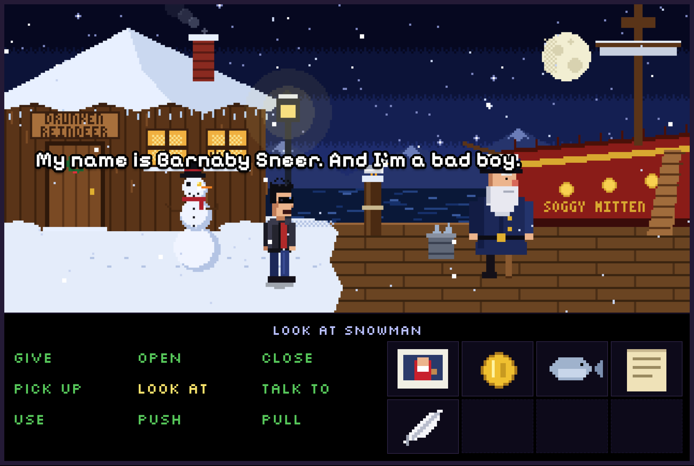
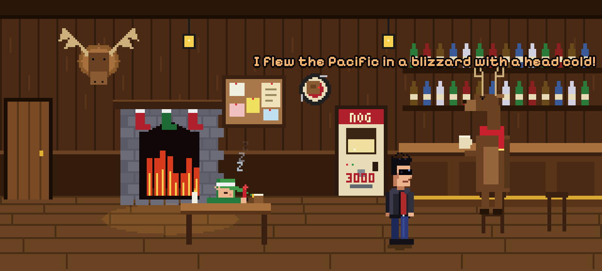
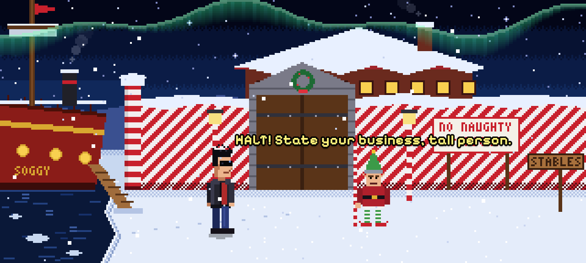
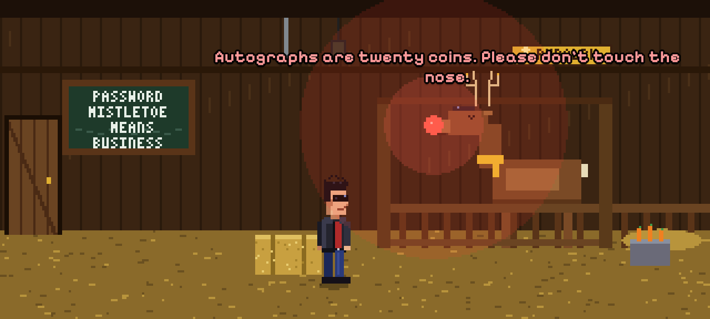
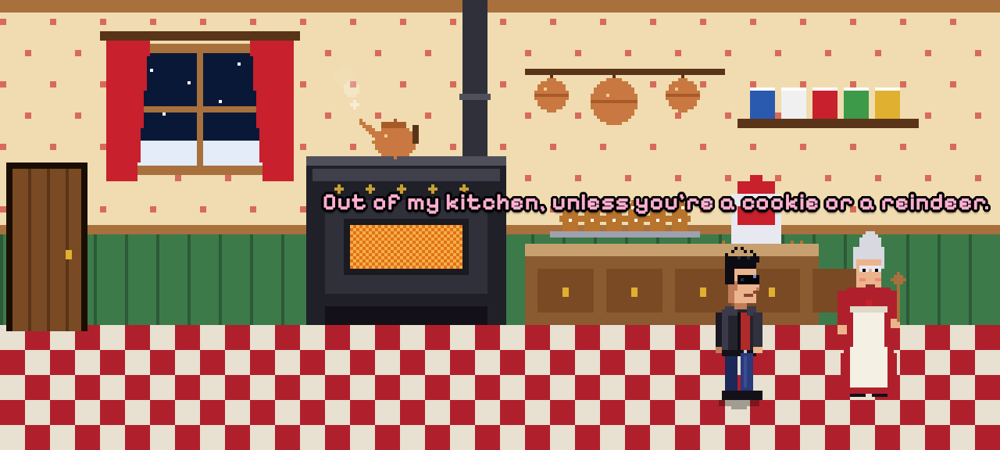
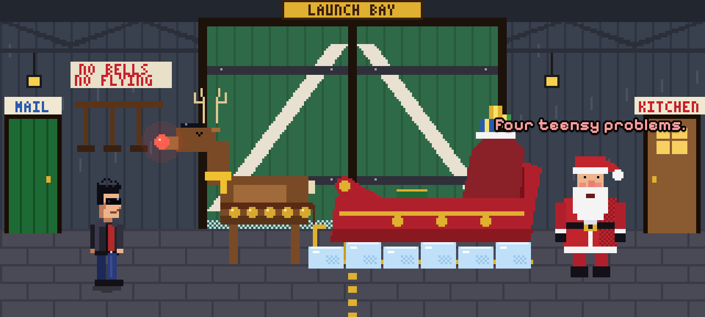
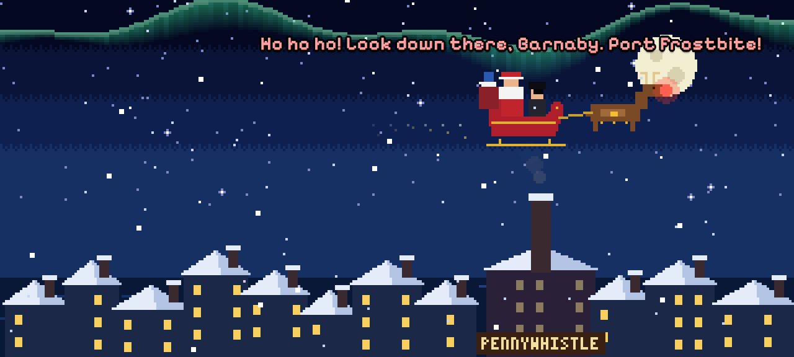
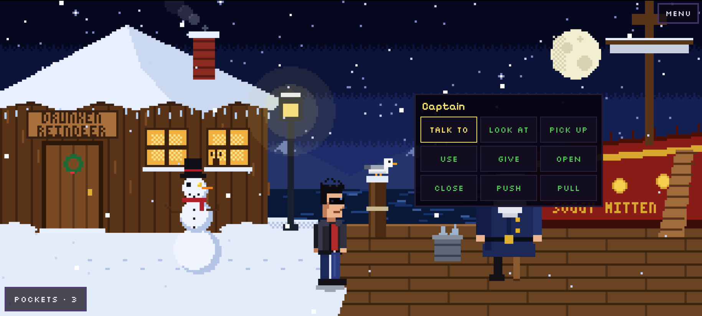

# The Naughty List Caper

A point-and-click Christmas adventure in the old pirate-island style. Bad boy Barnaby Sneer heads for
the North Pole to get his name off Santa's Naughty List.

Pixel art, a nine-verb interface, chiptune music and far too many jokes about herring. Plays in any
browser, or as a full-screen Android app.

**[Play it in your browser](https://jonsolberg.se:8080/Games/NaughtyListCaper/)** ·
**[Download the Android app](https://github.com/jonsolberg/naughtylistcaper/releases/latest/download/NaughtyListCaper.apk)**

  

## The story

Seventeen years ago, young Barnaby Sneer stayed up to catch Santa, took a photo of him in his long
johns with a mouth full of cookies, and sold it to the local paper. Every Christmas since: coal.

Tonight he's going to sail to the North Pole, find that list, and get his name off it. All he needs is
a boat, a certificate saying he's nice, a password, a way past a workaholic elf, and a good deal of
nerve. And then things get complicated.

  
  
  
  
  
  

## Features

- Thirteen hand-drawn pixel-art scenes, from Port Frostbite to Santa's sleigh hangar
- Six chapters of puzzles, with characters to talk to and dialogue options that disappear once they're used up
- The classic nine-verb interface: *Give, Open, Close, Pick up, Look at, Talk to, Use, Push, Pull*
- Right-click does the obvious thing: talks to people, picks up loose items, walks through doors
- A Hint button that always knows what to do next
- Original chiptune tunes, plus a reggae *Jingle Bells* in Santa's workshop
- Autosave, and three save slots of your own
- No ads, no tracking, no sign-up

## How to play

**On a computer:** pick a verb, then click something in the scene or in your pockets. For *Use* and
*Give*, pick the item first, then what to use it on or give it to. Click anywhere to skip a line of
dialogue.

**On a phone:** the scene fills the screen. Tap a person or thing and a small verb menu pops up with the
obvious action first. Long-press to do the obvious action straight away. Your items are behind the
*Pockets* button; Save, Load, Hint, Music and Quit are behind *Menu*.

  

## Download

**[Download the latest APK](https://github.com/jonsolberg/naughtylistcaper/releases/latest/download/NaughtyListCaper.apk)** · [all releases](https://github.com/jonsolberg/naughtylistcaper/releases)

To install the APK, allow your browser or file manager to *install unknown apps* when Android asks.
The app needs Android 5.0 or newer, plays in landscape, and works offline.

## How it's made

The whole game is one file, [`index.html`](index.html): the scenes are drawn in code at 320 × 144
pixels, and the music and sound effects are synthesised live with the browser's Web Audio. Open it in a
browser to play.
The only things it loads from the web are its two fonts.

The Android app in [`app/`](app) is a small full-screen wrapper around the same `index.html`. When the
app is built, the game and its fonts (from [`fonts/`](fonts)) are copied into it, so it works without
a connection.

## Building the APK

**Android Studio:** open this folder, let it sync, then *Build → Build App Bundle(s) / APK(s) → Build APK(s)*.
The APK ends up in `app/build/outputs/apk/debug/`.

**GitHub (no Android Studio needed):** the included workflow (`.github/workflows/build.yml`) builds the
APK on every push. Open the run under the *Actions* tab and download the `naughty-list-caper-apk`
artifact, unzip it and install the APK on the phone (allow installing from unknown sources when asked).

When the signing key is stored in the repository's secrets (`SIGNING_KEYSTORE_B64`,
`SIGNING_STORE_PASSWORD`, `SIGNING_KEY_ALIAS` and `SIGNING_KEY_PASSWORD`), the workflow signs the APK and
publishes it as a release. Without the key it builds a debug-signed APK and publishes nothing.

Note: debug builds made on different machines are signed with different keys, so to install a build from
a different machine over an existing install you may need to uninstall the old one first.

## Credits

- Fonts: [Pixelify Sans](https://fonts.google.com/specimen/Pixelify+Sans) by the Pixelify Sans Project
  Authors and [Silkscreen](https://fonts.google.com/specimen/Silkscreen) by the Silkscreen Project
  Authors, both under the [SIL Open Font License 1.1](fonts/OFL-PixelifySans.txt)
- *Jingle Bells* by James Lord Pierpont (1857), public domain

## Support

The Naughty List Caper is free, open source and has no ads. If you enjoy it, you can
[support me on Ko-fi](https://ko-fi.com/jonsolberg) ❤️

## License

Copyright © 2026 Jon Solberg

This program is free software: you can redistribute it and/or modify it under the terms of the
GNU General Public License as published by the Free Software Foundation, either version 3 of the
License, or (at your option) any later version.

This program is distributed in the hope that it will be useful, but WITHOUT ANY WARRANTY; without
even the implied warranty of MERCHANTABILITY or FITNESS FOR A PARTICULAR PURPOSE. See the
[GNU General Public License](LICENSE) for more details.
